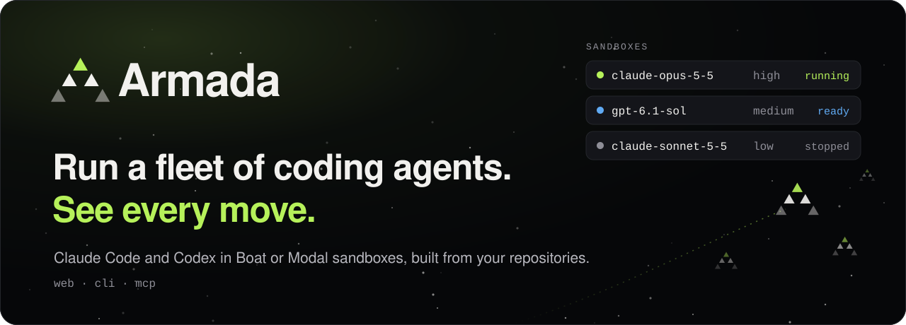

<p align="center">
  <a href="https://armada.thevibecompany.co">
    <picture>
      <source media="(max-width: 600px)" srcset="docs/images/armada-masthead-mobile.svg">
      
    </picture>
  </a>
</p>

<p align="center">
  <a href="https://armada.thevibecompany.co"><b>Open Armada in your browser</b></a>
  &nbsp;·&nbsp;
  <a href="#install"><b>Install the CLI</b></a>
  &nbsp;·&nbsp;
  <a href="#quickstart">Quickstart</a>
  &nbsp;·&nbsp;
  <a href="#documentation">Docs</a>
</p>

**Armada gives every coding task its own machine.** Snapshot your repositories once as a *golden*. Launch Claude Code or Codex into a fresh Boat or Modal sandbox with the model and reasoning effort you choose. Follow every event, redirect the agent mid-turn, stop the machine and pick the same conversation back up later, from the web, the terminal or any MCP client.

```sh
npm install -g @the-vibe-company/armada
armada login
```

Open source, MIT. Sandboxes run on the Boat or Modal account you connect, and agents on your own model credentials.

## Why Armada

- **Start from a ready workspace.** A golden snapshots your repositories, branches and setup after a secret scan; every launch forks it and pulls the latest commits.
- **Choose the agent and the brain.** Claude Code or Codex, with the exact model and reasoning effort you name. Armada never swaps in another model.
- **One task, one sandbox.** Each launch gets its own Boat or Modal machine, only that agent's credentials, and your GitHub identity once you connect it.
- **See and steer every move.** Follow events live, send the next prompt, steer or interrupt the running turn, run a command beside it.
- **Stop without losing work.** Stopping removes the machine but keeps the disk and the conversation; the next prompt resumes it.
- **Bring your tools and your team.** Attach the MCP servers you connected, share goldens with your org or keep them private, and give bots a service token.

## How it works

<p align="center">
  <picture>
    <source media="(prefers-color-scheme: dark)" srcset="docs/images/armada-how-it-works-dark.svg">
    
  </picture>
</p>

1. **Golden**: build once from your repositories (`armada golden create`).
2. **Launch**: pick Claude Code or Codex, the model, the effort and the provider (`armada launch`).
3. **Sandbox**: a fresh, isolated fork where `git` and `gh` act as you.
4. **Drive**: follow, steer, stop and resume (`armada logs --follow`, `armada send`).

The dashboard, the `armada` CLI and Armada's MCP server all call the same Armada server, so a sandbox launched from one is visible and controllable from the others, under the same permissions.

## Install

```sh
npm install --global @the-vibe-company/armada
armada --version
```

Or run it once without installing: `npx @the-vibe-company/armada --help` (or `bun x @the-vibe-company/armada --help`).

The package ships a prebuilt binary for Linux and macOS, x64 and arm64, so it needs Node 18 or later and nothing else. Do not install with `--omit=optional`: the binary is the optional dependency that matches your machine.

The CLI only talks to the Armada API. It keeps your Armada session (or reads `ARMADA_TOKEN`) and never holds provider, database or Supabase credentials.

## Quickstart

Installing is the first step; an agent also needs a sandbox provider, model credentials, GitHub access and a ready golden. Each step below also has a page in the [dashboard](https://armada.thevibecompany.co), which walks a new organization through the same setup.

**1. Sign in.** The browser opens (GitHub by default, `--provider google` for Google); `--email <address>` signs you in with a code from an email instead. Use `--url <armada-url>` (or `ARMADA_URL`) for another deployment.

```sh
armada login
```

**2. Choose an organization and connect a sandbox provider.** Create one (you become its admin) or ask an admin to add you with `armada org members add <your-email> --org <org>` after your first sign-in. An admin connects Boat or Modal once for the whole organization; the key is read from stdin or `--file`, never from an argument.

```sh
armada org create acme
armada org use acme
printenv BOAT_API_KEY | armada org connect boat --org acme
# Modal instead: printf '%s %s' "$MODAL_TOKEN_ID" "$MODAL_TOKEN_SECRET" | armada org connect modal --org acme
armada org setup --org acme
```

**3. Store your model credentials.** Your own credentials win over the organization's. Values are encrypted and never shown again.

```sh
printenv CLAUDE_CODE_OAUTH_TOKEN | armada creds set claude-oauth   # Claude Code (from `claude setup-token`); or kind `anthropic`
armada creds set codex-auth --file ~/.codex/auth.json              # Codex; or kind `openai`
armada creds list
```

**4. Connect GitHub.** Goldens are cloned over your own GitHub connection, and sandboxes use it so commits and pull requests come from you.

```sh
armada github connect
```

**5. Build a golden.** The server clones the repositories in a disposable sandbox, runs your optional `--setup` script, scans for leaked secrets and only then saves the snapshot. `--init` commands run at every launch, after the pull. Add `--provider modal` to build it for Modal. Only admins build organization goldens; members add `--private` to build one for themselves.

```sh
armada golden create web --repo https://github.com/acme/web@main --init "bun install" --org acme
armada golden list
```

A long build keeps running on the server: `armada golden build-status <job-id>` reports it.

**6. Launch an agent.** With a prompt the agent starts at once; without one the sandbox waits, ready, for your first prompt. In a golden with several repositories, `--repo owner/repo` starts the agent in that one ([details](docs/dave-onboarding.md#6-launch-from-the-cli)).

```sh
armada launch web --agent claude --model claude-opus-5-5 --reasoning-effort high --ttl 4h \
  "Find why the checkout test is flaky and fix it"
```

**7. Drive it.**

```sh
armada logs <sandbox-id> --follow
armada steer <sandbox-id> "Keep the public API unchanged"   # Codex restarts the turn with it
armada send <sandbox-id> "Now add a regression test" --reasoning-effort xhigh   # this turn only
armada extend <sandbox-id> --ttl 270m        # extend the 4h launch to 4h30m from now
armada stop <sandbox-id>                     # the machine goes; the disk and conversation stay
armada send <sandbox-id> "Push the branch"   # resumes the stopped sandbox
```

Extend an accessible running or idle sandbox as its owner or an org admin. The new deadline must be later than the current one and within server/provider limits. Boat resets its hard timer; Modal extensions must fit before the existing physical deadline minus a five-minute stop margin, without replacing the machine. Modal launch headroom is server-configured; see [sandbox lifetime limits](docs/sandbox-expiry-investigation.md#initial-delivery-scope).

`armada --help` lists every command. Without flags, Claude Code runs `claude-opus-5-5` and Codex `gpt-6.1-sol`, both at `medium` effort.

## Bring your MCP servers

Register an MCP server once, connect it (the browser opens when it asks for OAuth), then attach it to the sandboxes that need it. Only connected servers can be attached, and tokens never go on the command line. A personal connection attaches to private sandboxes; an admin shares one with the whole organization with `--scope org`.

```sh
armada mcp add Docs https://mcp.example.com/mcp      # personal; --scope org shares it with your org
armada mcp connect <connection-id>
armada launch web --agent codex --visibility private --connections <connection-id> "Update the API reference"
armada mcp sandbox-connections <sandbox-id>
```

Details: [docs/cli-capabilities-and-mcp-shortcuts.md](docs/cli-capabilities-and-mcp-shortcuts.md).

## Drive Armada from your own agent

Armada is also a remote MCP server. Add it to Claude Code, Codex, Cursor or your own orchestrator, and that agent can list and build goldens, launch sandboxes and drive them with `golden_list`, `golden_create`, `launch`, `list`, `status`, `wait`, `logs`, `send`, `steer`, `interrupt`, `exec`, `extend` and `stop`.

MCP clients sign in with OAuth; bots and CI use a service token bound to one organization:

```sh
armada token create --org acme --label ci   # printed once; Armada keeps only its hash
```

Your orchestrator decides what to work on and when to merge; Armada gives each task a sandbox, an agent and a live event stream to drive. Endpoints and client configuration: [Connect an MCP client](docs/dave-onboarding.md#7-connect-an-mcp-client).

## Teams

| | Admin | Member |
| --- | :---: | :---: |
| Launch, watch and stop the organization's agents | ✓ | ✓ |
| Create private goldens and private sandboxes | ✓ | ✓ |
| Change organization goldens, members and provider keys | ✓ | |

A private golden or sandbox is visible only to its owner, not even to admins. Members are people who have signed in once; there are no pending invitations.

## Documentation

| Read this | When you want to |
| --- | --- |
| [Production onboarding](docs/dave-onboarding.md) | Go from nothing to a running agent, CLI or MCP, step by step |
| [Golden creation](docs/golden-create.md) | Understand the secure build, its security model and its API |
| [GitHub identity in sandboxes](docs/github-app.md) | Know what `git` and `gh` can do as you, and set up the GitHub App |
| [Run, deploy and develop](docs/self-hosting.md) | Run `armada-server` and the dashboard yourself, or work on this repository |
| [Releasing](docs/releasing.md) | Publish the CLI to npm |
| [Specification](https://github.com/The-Vibe-Company/armada/issues/455) | Read the v2 design |

## Armada v1

This repository used to hold Armada v1, a fleet orchestrator (Linear, merge queue, desktop app; npm versions up to 0.2.73). Its last commit is tagged [`armada-v1-final`](https://github.com/The-Vibe-Company/armada/tree/armada-v1-final), and its history and release tags stay here. v2 replaces it under the same `@the-vibe-company/armada` package: installing the latest version upgrades the global CLI.

## License

[MIT](LICENSE)
