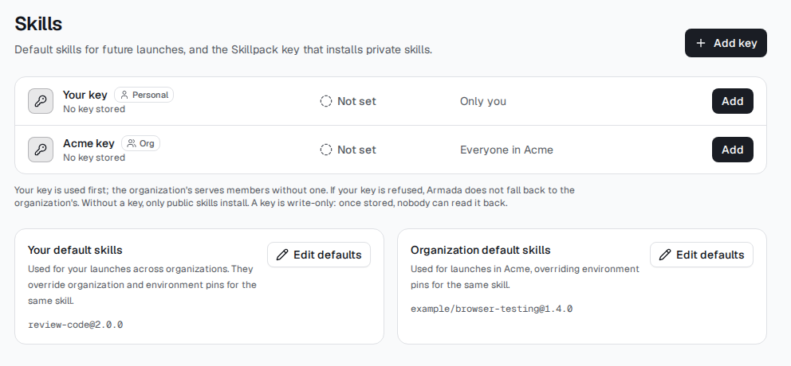
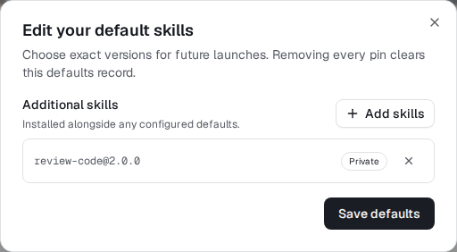

# Configure default skills (#1007)

Build > Skills now shows personal and organization default pins beside the
existing key management. Environment details have their own default editor.
Editing uses a centered dialog with the shared Skillpack picker. Metadata reads
and saved lists are validated before enabling Save; failure is not an empty
record. Removing every selected pin and saving explicitly clears that scope.

Members can read shared defaults but only admins edit organization/shared
environment defaults. Private environments remain owner-managed. The server
rechecks current membership/visibility; UI controls are not the authorization.

Ordinary Launch > Advanced has **Apply default skills**, on by default. Turning
it off sends the existing per-launch opt-out while keeping explicit selections.
Defaults are for future launches, not a retroactive change to existing boxes.

## Real dashboard evidence (synthetic fixtures)

These images are captured after real browser assertions against the production
dashboard build and local mock services. They are cropped only for readability.

No migrations. Requires the existing defaults API and shared picker slices.
Coordinator staging: set all three scopes, verify documented precedence and
both providers' receipts, clear a scope, opt out for one launch, and confirm
members cannot edit shared records. Workers hold no staging credentials.
