# Issue #2522 visual evidence

Templates snapshot badges escaped their cards on a phone and widened the page. The fix bounds every shared catalog
chip (`RowTag`) to its container and truncates the label inside it, keeping the icon. Captured at 390×844 in both
themes against the Large fixture (longest names), prototype first.

Before the fix, the Large Templates page measured `document.documentElement.scrollWidth = 713` at `innerWidth = 390`
in both themes; the first snapshot badge ended at x=706. After the fix every catalog page and the sandbox list
measure 390, and no chip crosses its card's right edge.

| State | Prototype | Build |
| --- | --- | --- |
| Templates, light | 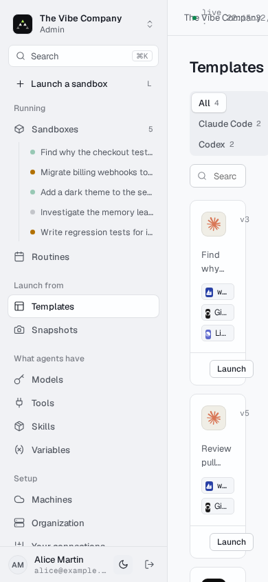 | 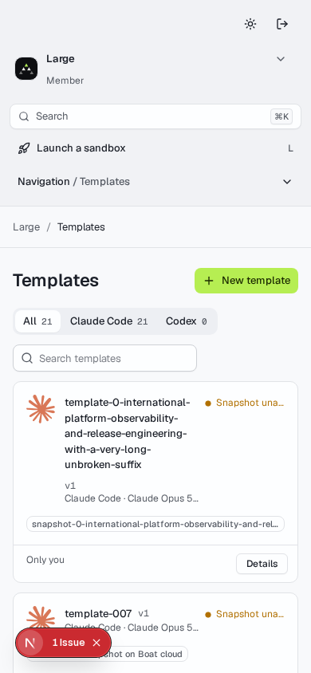 |
| Templates, dark | 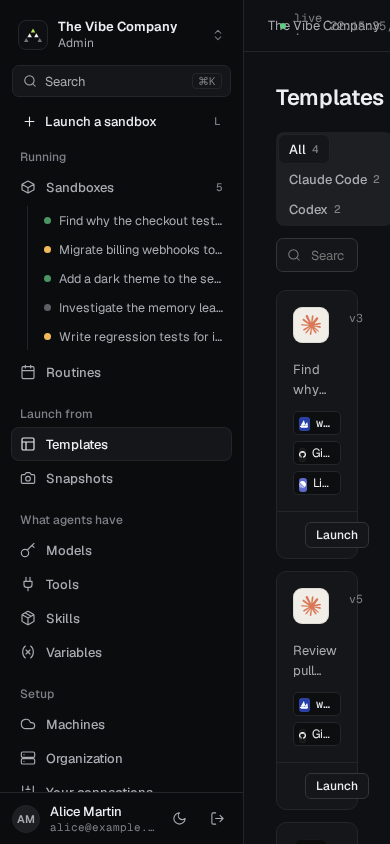 | 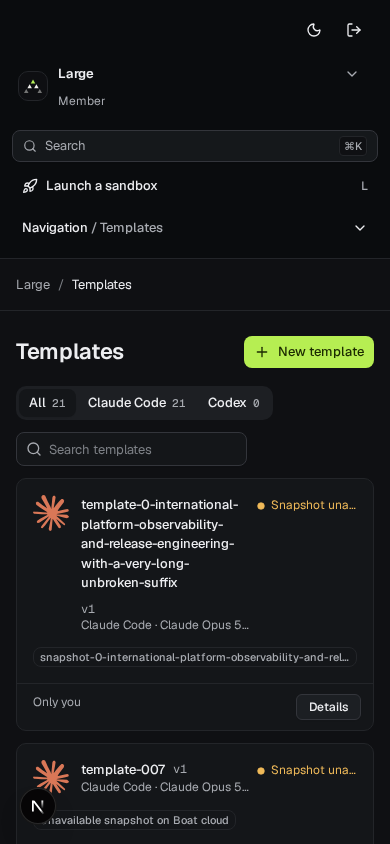 |
| Snapshots, light | 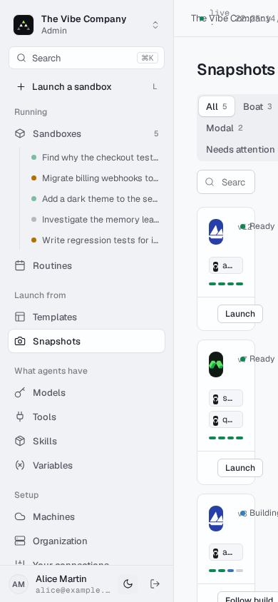 | 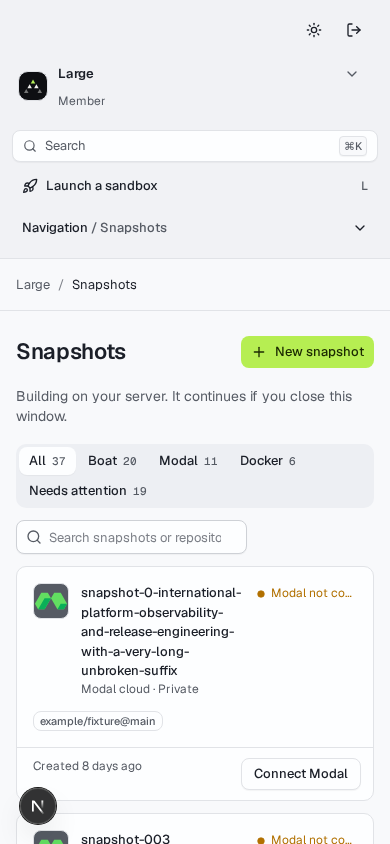 |
| Snapshots, dark | 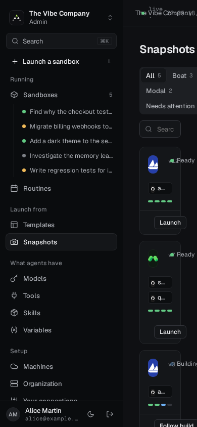 | 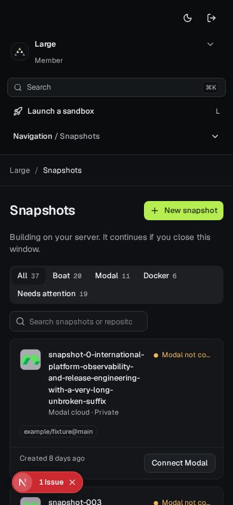 |
| Sandboxes, light | 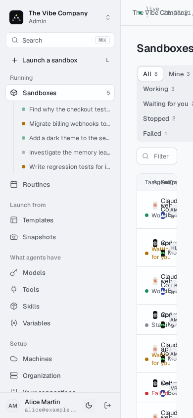 | 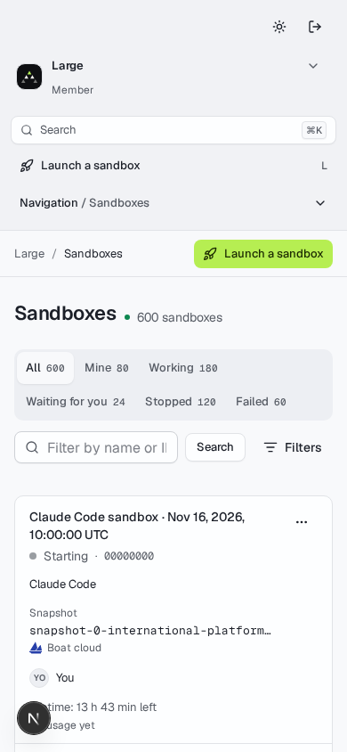 |
| Sandboxes, dark | 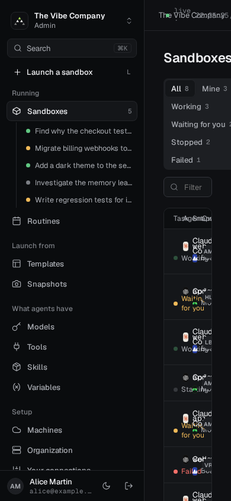 | 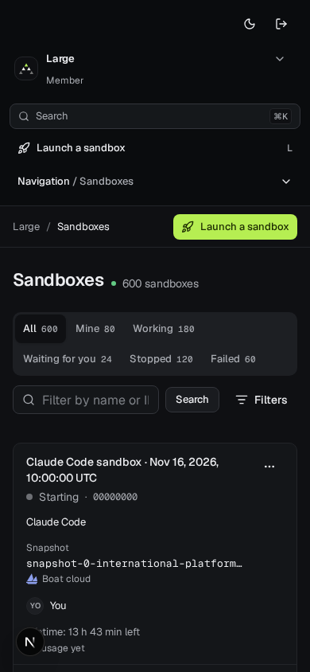 |

The prototype has no phone media query (fixed 244px sidebar) and selects org switcher data that clips some of its
main column at 390px; the pair shows the chip-containment contract (`max-width:100%` with an ellipsized label), not
layout parity. The Large fixture supplies stress names the prototype does not contain, so the overflow finding is
established by local execution plus that contract, not identical fixture names.

Validation: lint, strict typecheck, dashboard unit tests and the new phone journey pass. The journey fails on the
unfixed code (`713` vs `390`) and passes with the fix. No migrations or deployment prerequisites.
