# Three-group navigation — draft pending owner confirmation

**Do not mark ready or merge until the coordinator relays the owner's confirmation of this structure.** Refs #1038. The immediate removal of sidebar sub-text is the separate, independently ready #1152; this draft builds on it.

## Proposed structure

```text
Run                 Library             Account
  Sandboxes           Environments        Models (/harness unchanged)
  Routines            Skills              Organizations
  Templates           Tools               Settings
                      Variables
```

Exactly three one-word group labels, destination names and icons. No descriptive sentences beneath groups or items. Collapsed tooltips repeat only destination names, not explanations.

## Implementation

- Retain shadcn SidebarGroup/GroupLabel/Menu/MenuButton, existing icons and active styling; use the native icon-collapse mode with visible collapse/expand controls. The phone keeps its modal Sheet, Escape/backdrop behavior and focus restoration.
- Rename the Harness page, its loading title, menu/search label and in-app guidance to Models. `/harness`, credential APIs and domain types remain unchanged; searching "harness" still finds Models. Existing route redirects remain intact.
- Relationships stay on pages: template ingredient chips and environment backlinks from #1143 remain. Tools and Variables/Secrets panels now show caller-visible current template references; Skills shows templates with skill pins, explicitly not a count of Skillpack-key usage. Lists use the existing authorized template API, once per page (plus current revision reads), not per ingredient row. Missing reads stay unknown/partial rather than false zeroes.
- The template ingredient panel follows environment, model, skills, tools, variables/secrets. Existing ad-hoc and preset launch flows already order supported Library ingredients as environments → skills → tools → variables; no skill-picker or launch-protocol changes are needed.
- Capture helpers accept the old or new Models heading only for baseline evidence; candidate evidence strictly requires Models. No migrations, provider operations or production deployments.

## Local validation

Navigation is exercised in light/dark, desktop/phone, expanded/icon-only states: exact group/item order, current route, complete first icon, expand/collapse, Escape/focus and the unchanged Models URL. Cross-link tests traverse resource → template links for every Library family and preserve unreadable-revision/secret-metadata checks. Broad targeted suite: 42 passed; after the final collapsed-label visual fix, all four navigation variants passed again. Dashboard unit tests: 431 passed. Lint/typecheck and diff checks passed. CI and independent review belong to coordinator automation; no polling.

## Before / after

Before: #1152 at `8d70b72b04aacd454d311141d517e098339217b2` (sentences already removed; old five-group structure). After: this draft. Same mock organization/data, 1280×900 desktop and 390×844 phone. Expanded desktop crops preserve readable sidebar text; click them for full-viewport context. Icon-only before images show the previous off-canvas behavior.

### Light — desktop

| Before | After |
| --- | --- |
| [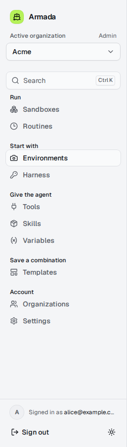](navigation-structure/navigation-structure-before-desktop-light.png) | [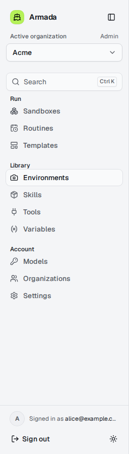](navigation-structure/navigation-structure-after-desktop-light.png) |

### Light — icon-only desktop

**Before**

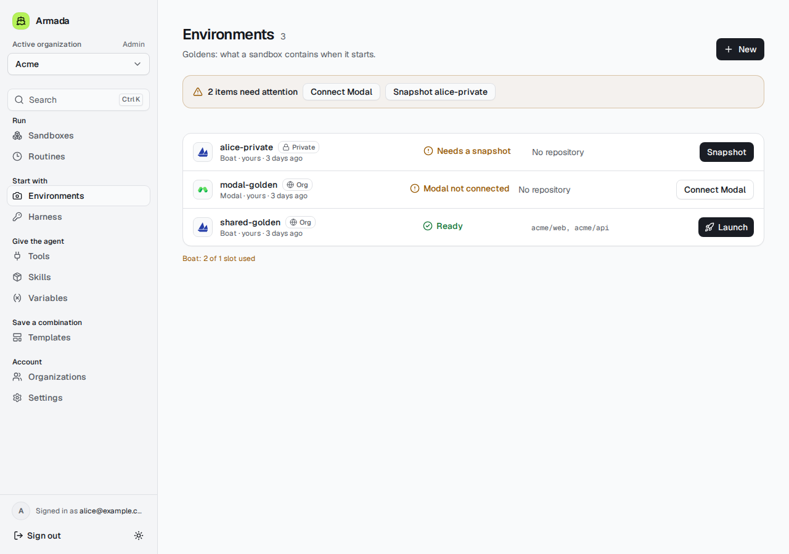

**After**

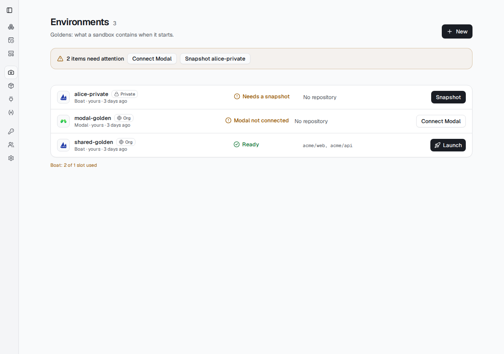

### Light — phone

| Before | After |
| --- | --- |
| 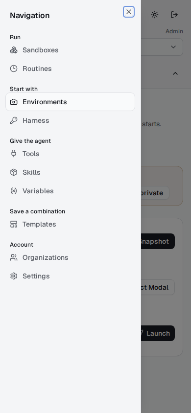 | 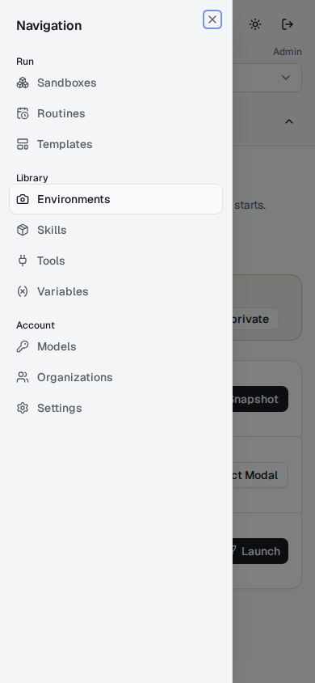 |

### Dark — desktop

| Before | After |
| --- | --- |
| [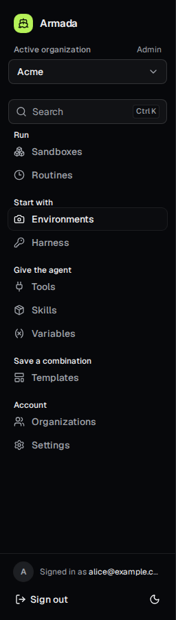](navigation-structure/navigation-structure-before-desktop-dark.png) | [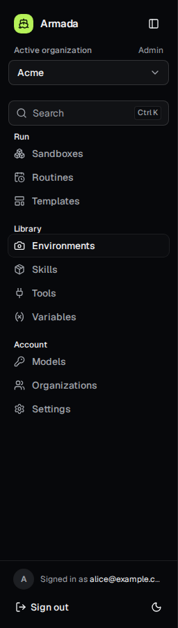](navigation-structure/navigation-structure-after-desktop-dark.png) |

### Dark — icon-only desktop

**Before**

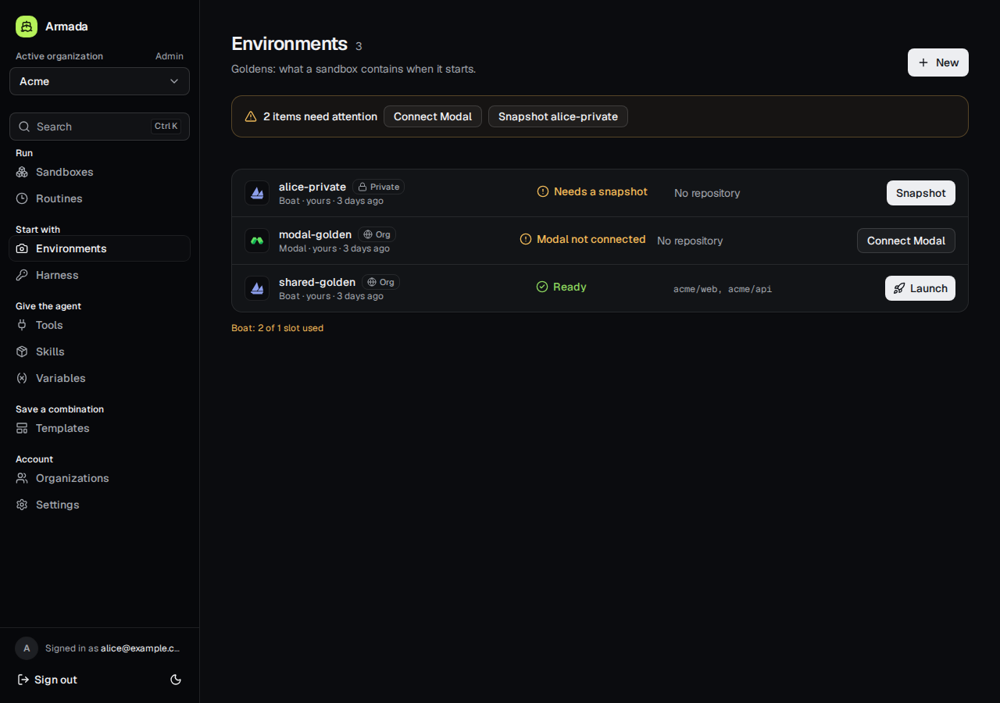

**After**

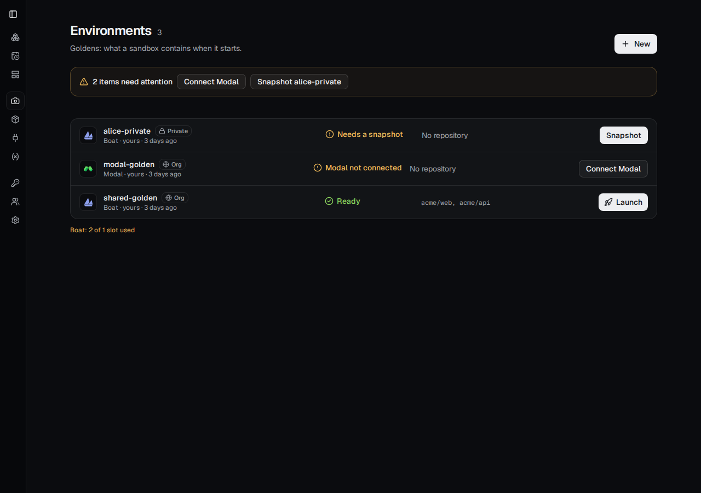

### Dark — phone

| Before | After |
| --- | --- |
| 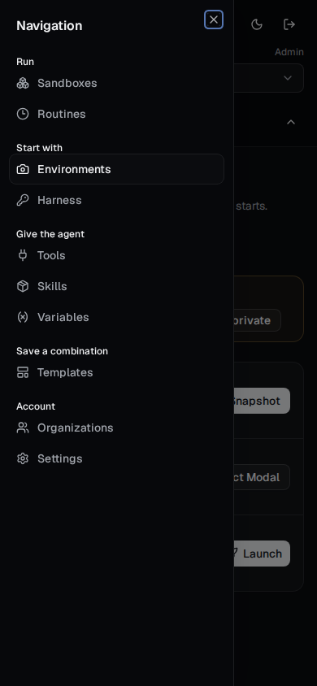 | 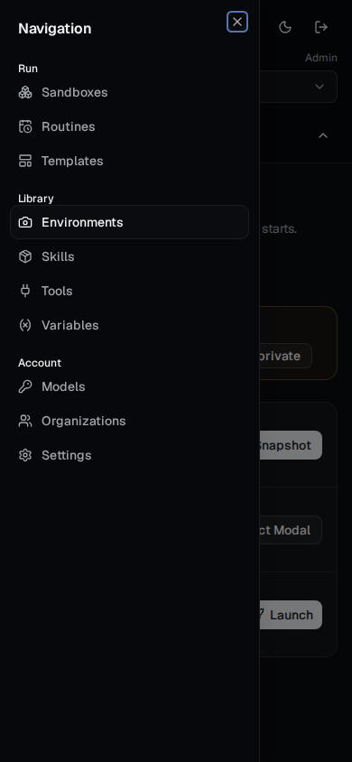 |

## Relationships on the pages, not in the menu

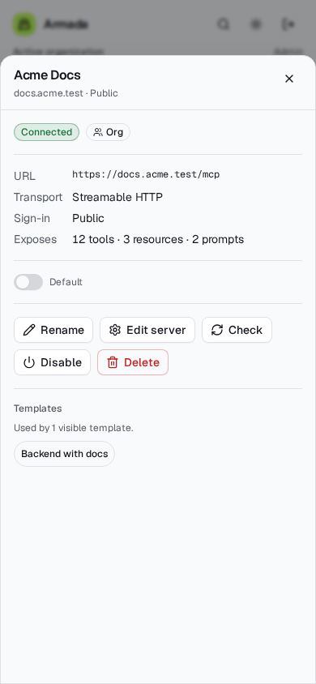

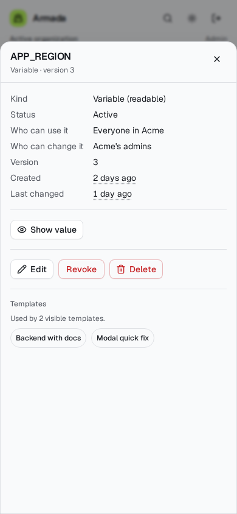
