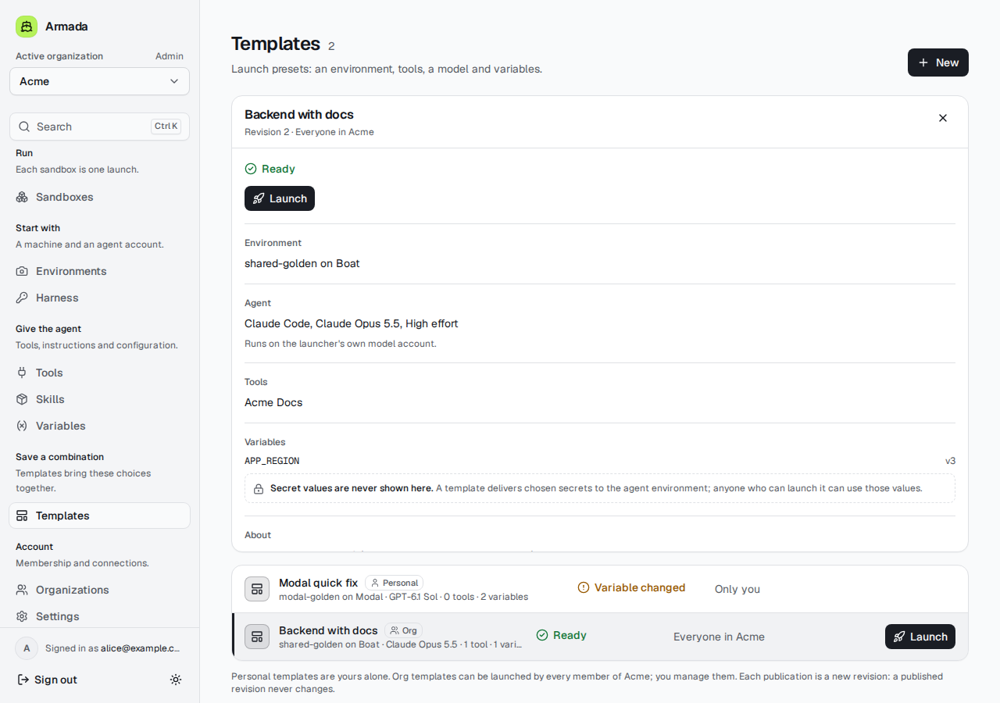
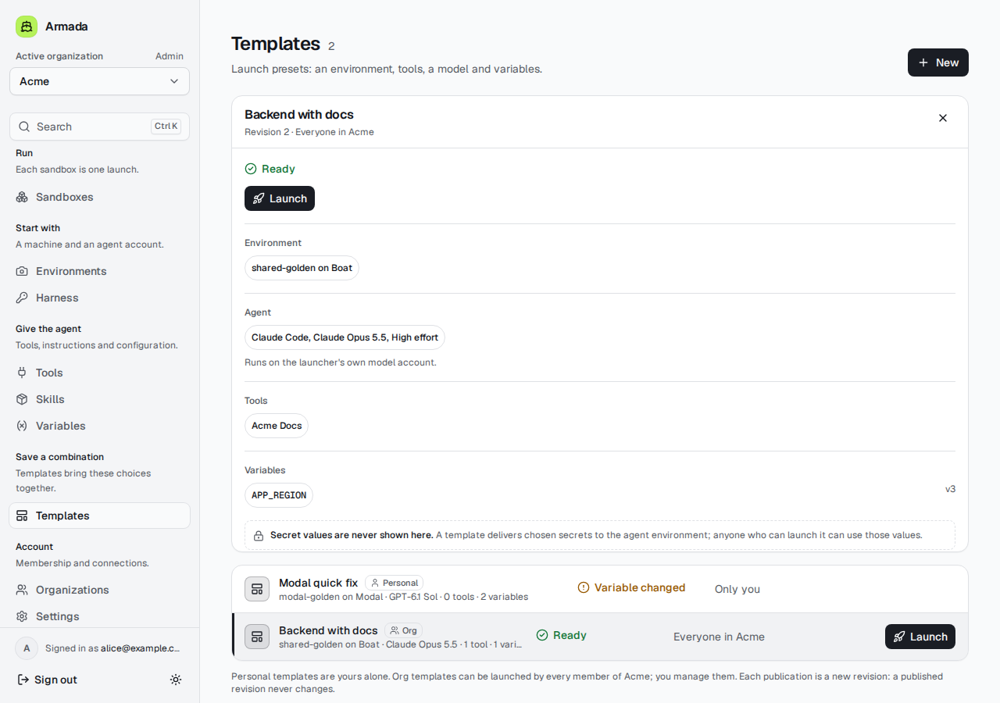
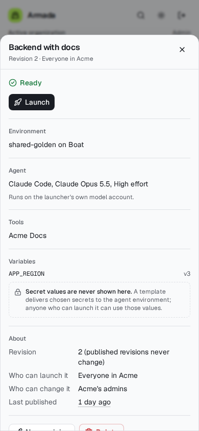
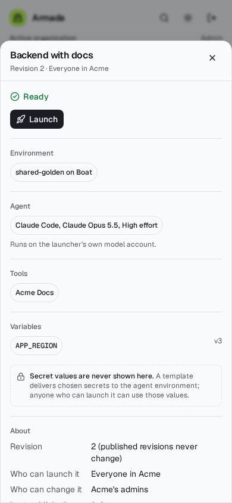
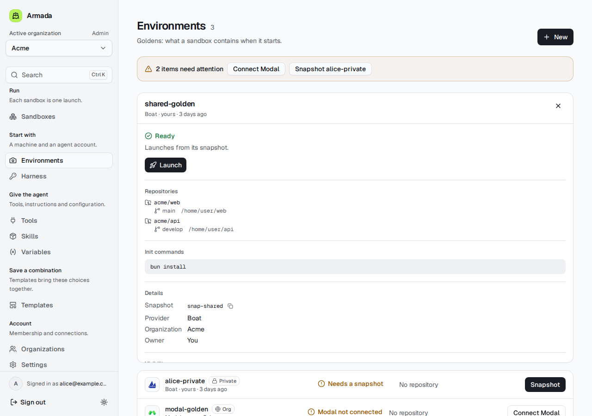
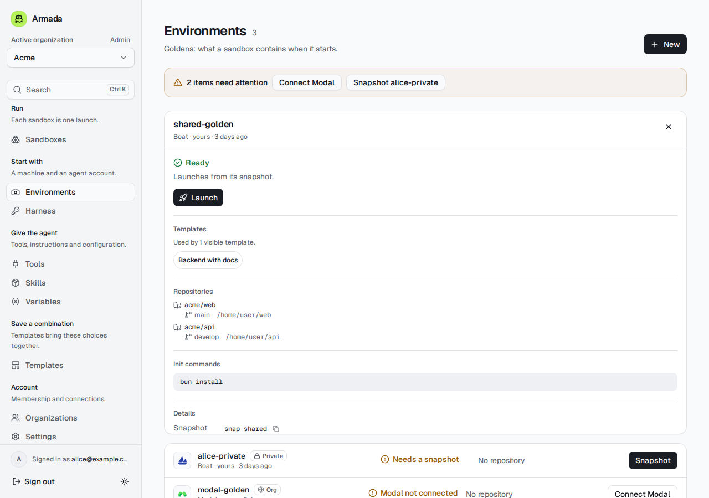
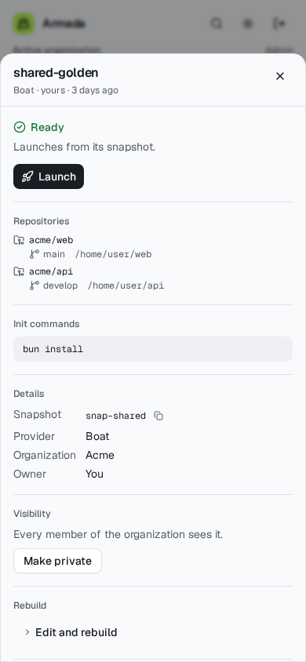
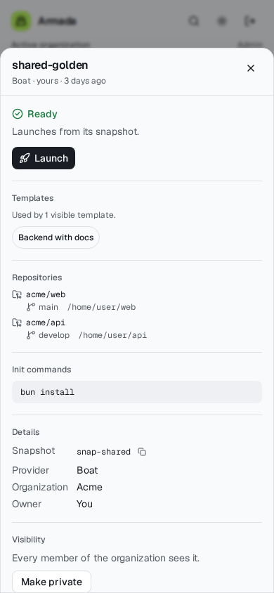
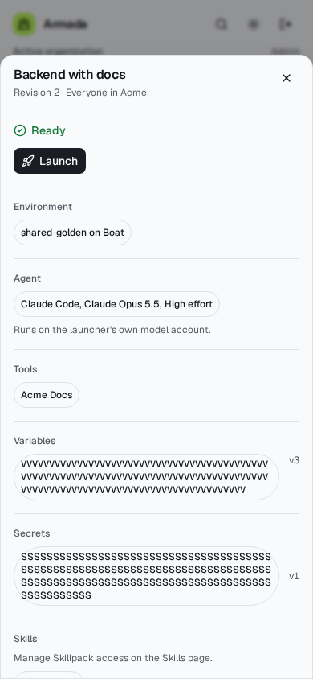

# Template ingredient links — #1038, next slice

Follows #1040's relationship-first navigation. The template panel's environment, agent, tools, variables, secrets and skill pins are links to their existing management pages. Environments list the current visible templates that reference them, with links back to the template panel.

## Design and boundaries

- Keep the existing Geist face, graphite surfaces, section rhythm and sidebar unchanged. Outline shadcn Badge links distinguish resource references from state labels. Labels wrap, with focus rings and 32px minimum touch targets.
- Use existing selected-item URLs (`?item=`); preserve variable/secret key namespaces. Harness and Skills link to their management pages, not invented per-model or per-skill routes. Skills explicitly says this manages Skillpack access.
- Reuse the caller-visible lists already loaded by these pages: no additional network/database calls, new endpoints, migrations or authorization changes.
- Only link ingredients that are present in the caller-visible lookup; missing resources stay unavailable text. Secret links use IDs/names/version metadata only; no value is read or displayed.
- Environment usage counts current visible template revisions, not successful launches. Templates with launch blockers still count. Unreadable revisions produce a lower bound and a clear partial-read notice, never a false zero. An unavailable list says usage could not be read.
- This is deliberately the first cross-link slice: reverse links on Tools/Variables/Harness/Skills, running-sandbox counts and empty-state guidance remain follow-ups. No launch-dialog redesign or changes to Sandboxes, Routines or skill pickers.

## Validation

Browser coverage follows a template → environment → template → variable on desktop and phone, verifies the tool/account destinations, checks partial-revision usage and secret/skill metadata links. Existing Templates and Build-section checks run alongside it. Dashboard unit tests and full-repo lint/typecheck also run locally. Independent review and CI belong to coordinator automation; no CI polling.

## Before / after captures (mock data)

Baseline: the template/environment page sources at `368423dcb1d5d1db3fd5bc48982f25e67116639f` (this slice's original base), rebuilt against the same disposable mock. Desktop: 1280×900; phone: 390×844; light theme. After captures use this PR's implementation. Images link to full-resolution captures.

### Template ingredients — desktop

**Before**

**After**

### Template ingredients — phone

**Before**

**After**

### Environment → templates — desktop

**Before**

**After**

### Environment → templates — phone

**Before**

**After**

### Phone: long-key regression

Both keys below are valid 128-character synthetic identifiers. The browser regression checks individual text-fragment bounds, link/row overflow and version-label bounds inside the sheet. It fails on the pre-fix badge (one clipped line) and passes with shrinking and unbroken-text wrapping enabled.

