# Sandbox thread fidelity evidence (#2511)

Captured in this delivery session using Playwright Chromium 1254, the prototype served with `python3 -m http.server 8091 --directory docs/design/refonte-2026-11-16`, and fixture dashboard `bun run dev`. Linux libraries and font configuration were supplied under `/tmp`; no deployed service or provider was used.

The fixture is Acme, signed in as Alice. Working uses the default recorded prompt/message/tool events. Other lifecycle captures change only the sandbox status with the existing fixture lifecycle endpoint; the retained history is unchanged. These are comparisons of layout/state controls, not identical task content. Prototype phone rows were selected by dispatching their click event because the prototype overlay intercepts pointer input.

| State / viewport / theme | Prototype | Fixture |
| --- | --- | --- |
| working / 1440×900 / dark | 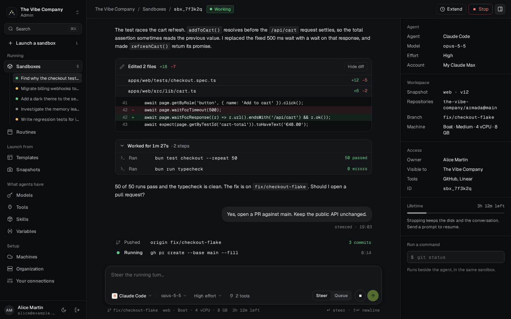 |  |
| working / 1440×900 / light | 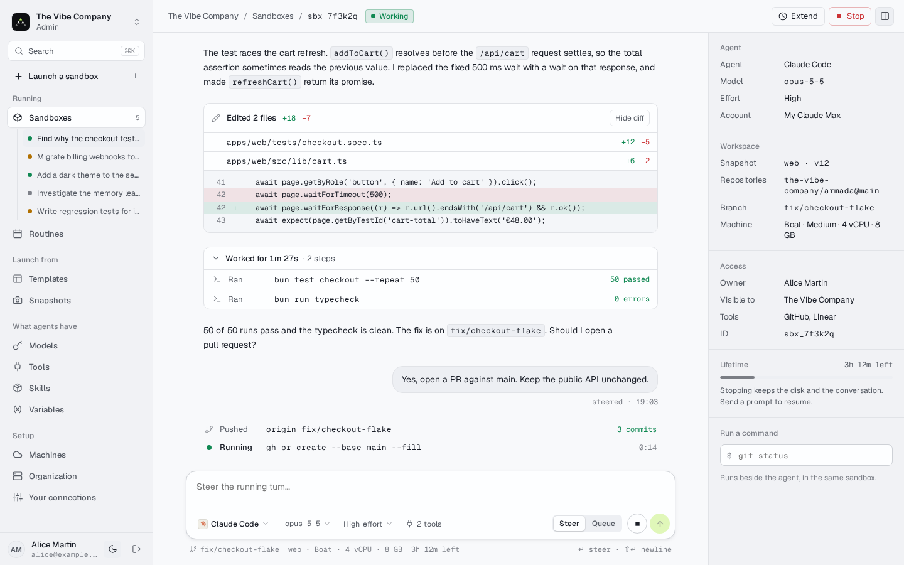 |  |
| working / 390×844 / dark |  | 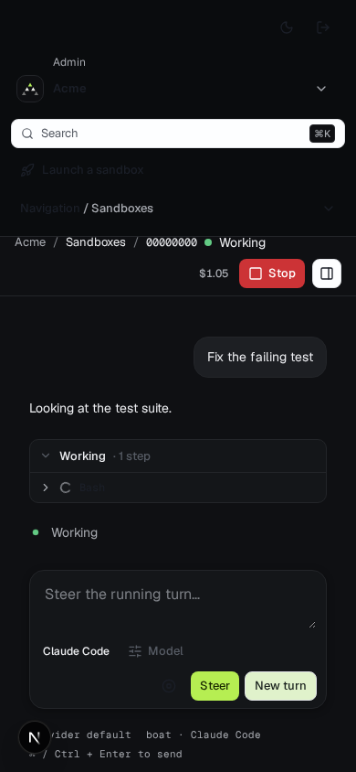 |
| working / 390×844 / light |  | 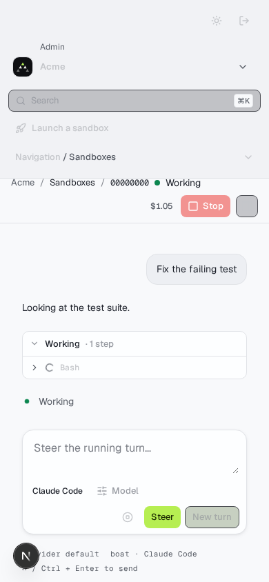 |
| waiting / 1440×900 / dark | 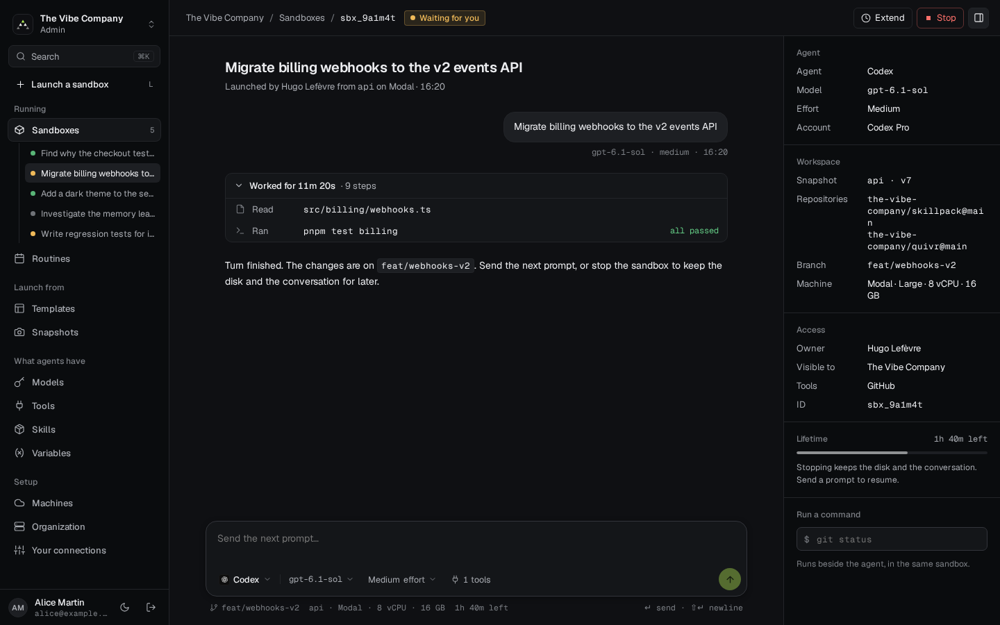 |  |
| waiting / 1440×900 / light |  | 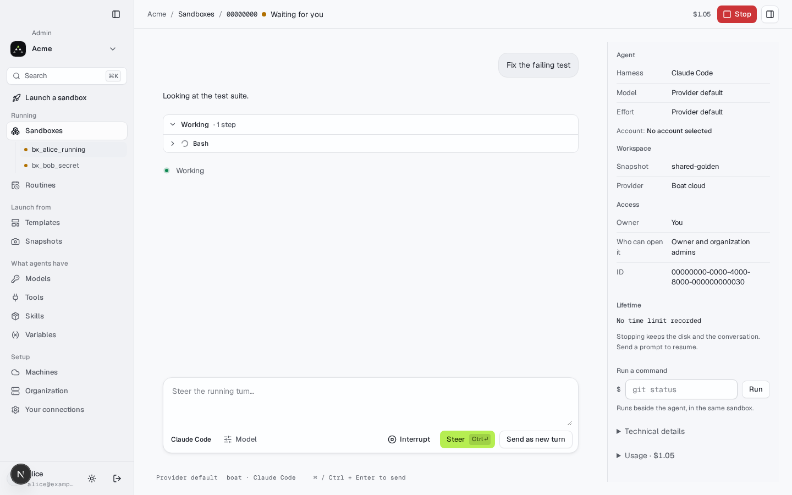 |
| waiting / 390×844 / dark | 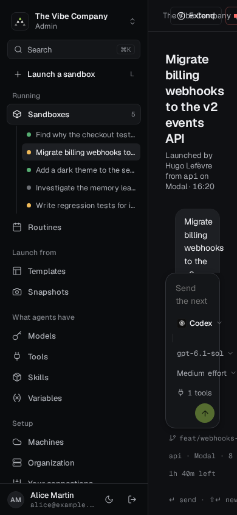 |  |
| waiting / 390×844 / light | 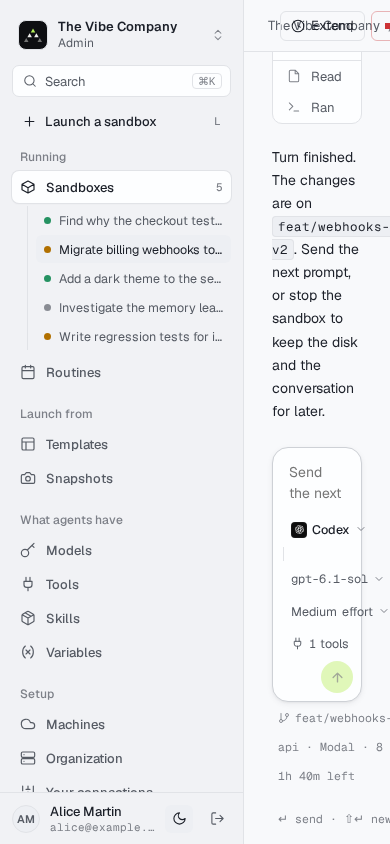 | 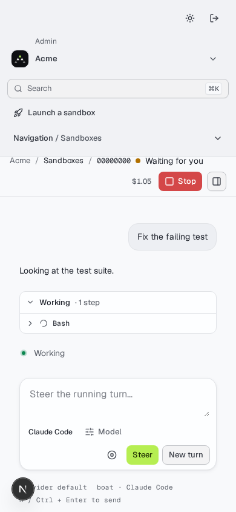 |
| stopped / 1440×900 / dark | 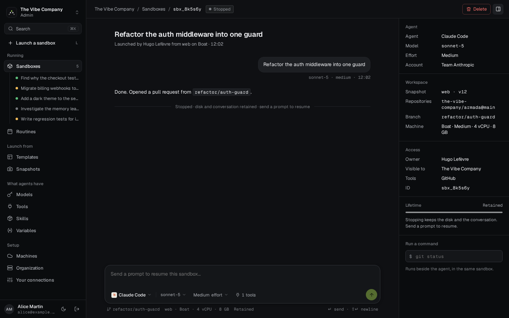 |  |
| stopped / 1440×900 / light |  | 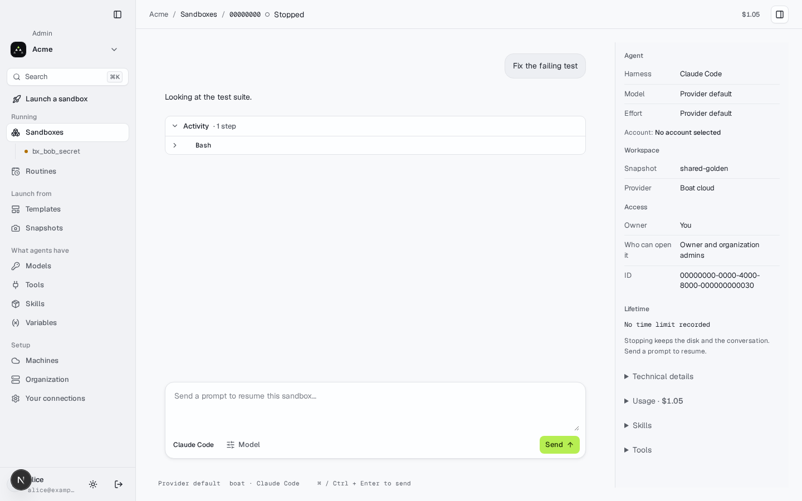 |
| stopped / 390×844 / dark | 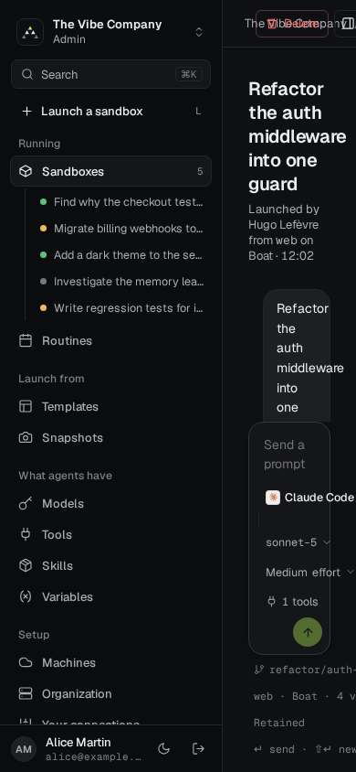 | 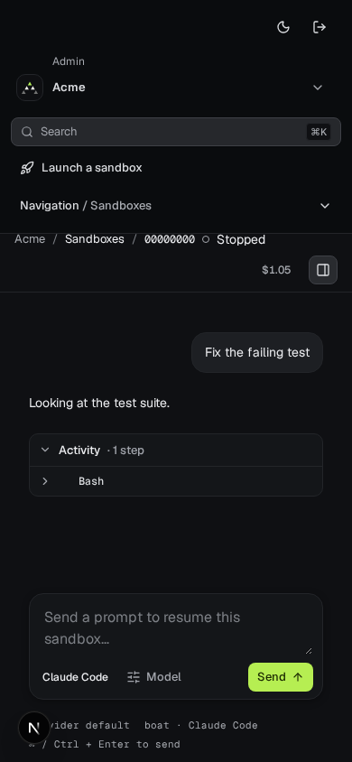 |
| stopped / 390×844 / light | 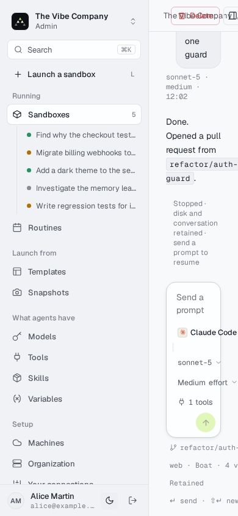 |  |
| failed / 1440×900 / dark |  | 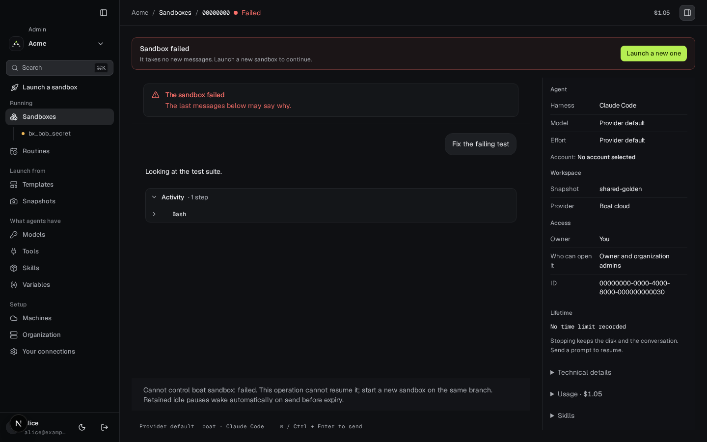 |
| failed / 1440×900 / light |  | 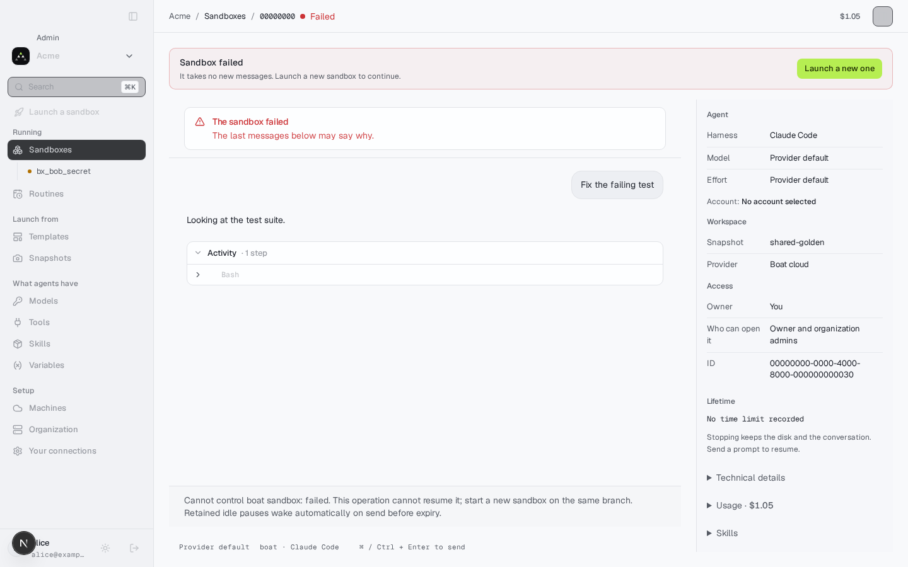 |
| failed / 390×844 / dark |  | 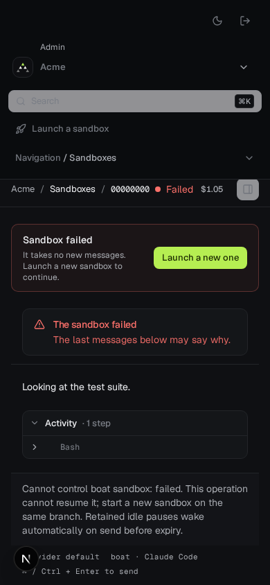 |
| failed / 390×844 / light | 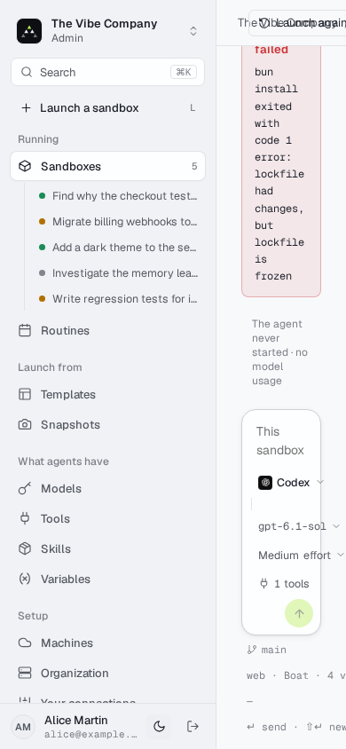 |  |

## Delivered

The shell owns the sole breadcrumb and adjacent status. Page-owned authorized actions are portalled to the shell. Details use an accessible icon toggle. Both cloud and Docker threads omit the redundant launch title block, and the conversation omits its extra heading/live badge while retaining conversation selection when applicable. Fact values use a consistent left-aligned second column. Full UUIDs remain available as breadcrumb tooltips.

## Validation

- `bun run lint`: passes, with the pre-existing routines CSS specificity warning.
- `bun run typecheck`: passes.
- `bun test apps/dashboard/test/chat.test.ts apps/dashboard/test/composer.test.ts`: 14 pass.
- Playwright against the existing fixture development server, temporary config overriding only server startup: updated live-refresh and stop/resume journeys (`sandboxes.e2e.ts:147` and `:174`): 2 pass.
- Independent review-code-dev Alibaba review: six source/journey files reviewed; reported static findings fixed and re-reviewed. Full acceptance remains incomplete.

## Gaps — not acceptance evidence

- Composer model/effort remain in the disclosure, and the existing Steer / Send as new turn controls remain. Queue is a different contract; no queue semantics or launch-bound harness/tools switches were invented.
- No completed matrix for Large organization, expired lifecycle, edited-file diff shown/hidden, command results, or pushed/running lines. Existing prototype working screenshots include its rich diff/command/push blocks; the default fixture history does not exercise those blocks.
- Phone shell and composer still differ visibly from the prototype. These captures do not establish element-by-element fidelity.
- The full dashboard journeys have not been run; only the two updated thread journeys were run.

Migration files: none. Deployment prerequisites: none added. No deployments, production reads/writes, or migrations performed.
