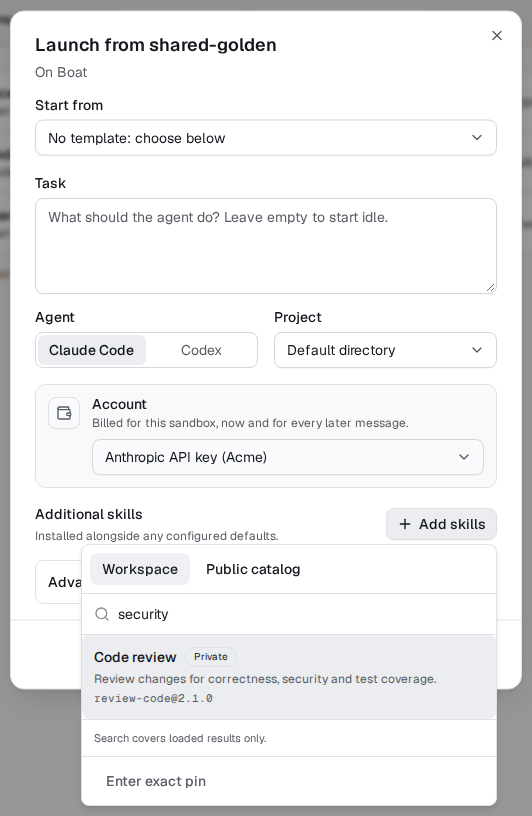
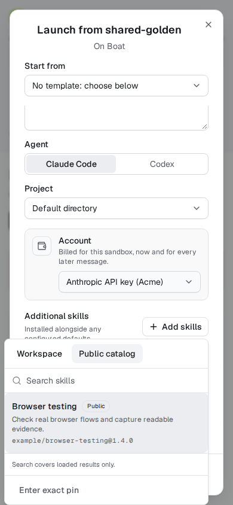
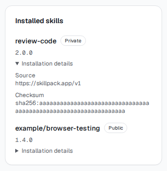

# Launch with Skillpack skills (#1007)

This dashboard slice adds **Additional skills** to ordinary environment launches,
and shows recorded installation receipts inside authorized sandbox Details.
Templates and default editors follow as separate small slices.

The picker reads the caller's connected workspace or the public catalog, showing
name, description, visibility and exact version. Search explicitly covers loaded
results; additional pages can be loaded. Select a skill, choose a published exact
version, then add it. Catalog failures do not block a plain launch: exact-pin
entry remains available. Missing/refused keys link to Build > Skills.

Selections are additions/overrides to the existing environment/org/personal
defaults, not a preview of all resolved defaults. Empty selections omit the
launch field. Server and browser share a browser-safe exact-pin policy; the
backend remains the installation/receipt authority. No key is passed to the
browser, and discovery does not install anything.

Stored receipts are read with the existing authorized sandbox detail data, not
through extra catalog requests. Private metadata-only viewers do not receive
receipt contents. Missing or malformed historical receipts are ignored; no
internal skill/workspace IDs are displayed.

## Screenshots

Captured from the real production dashboard against synthetic local fixtures,
after passing browser assertions. Images are cropped only for readability.

### Search the connected workspace

### Public catalog on a phone, with an exact workspace pin selected

### Recorded installed pins and verification details

## Checks and rollout

No migrations. Requires the catalog API slice (PR #1043); public browsing still
depends on Skillpack's existing anonymous catalog being enabled. Exact-pin entry
and private browsing are independent of public availability.

Coordinator staging: select a visible workspace skill/version and a public pin,
launch on Boat and Modal, inspect both receipts, then try a missing/revoked key.
Confirm selected skills remain editable after launch refusal and that a member
without sandbox interior access cannot see its receipts.
