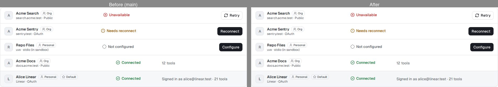
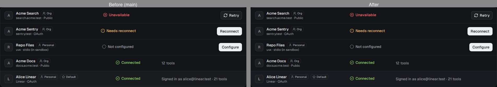
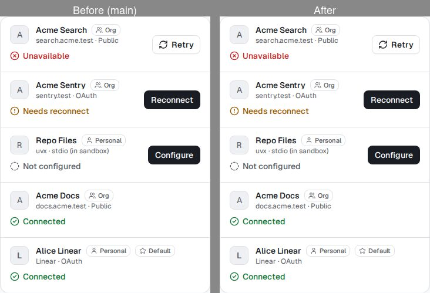
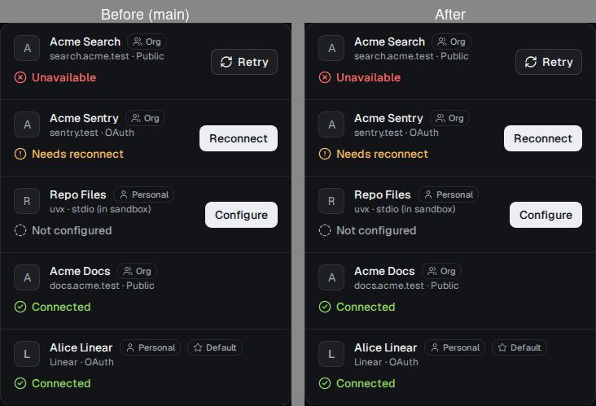
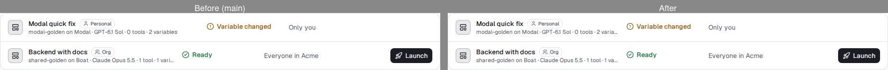
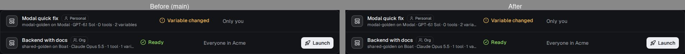
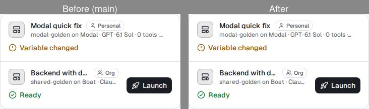
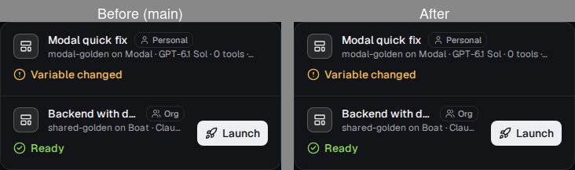

# #1153: list columns shared across rows

Before (main) on the left, after on the right. The same mock data, captured from fresh production builds of both
sides. Desktop (1280 px) and phone (390 px), light and dark.

Desktop: the state and fact columns now start at one x in every row, whatever the width of the row's action (Retry,
Reconnect, Configure, Launch or none). Phone: unchanged; a row without an action keeps the whole width for its name.

## Tools

## Templates

