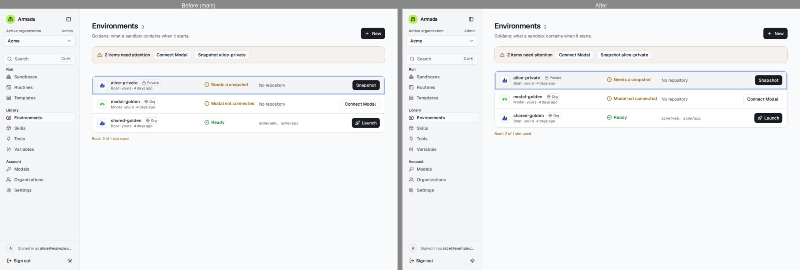
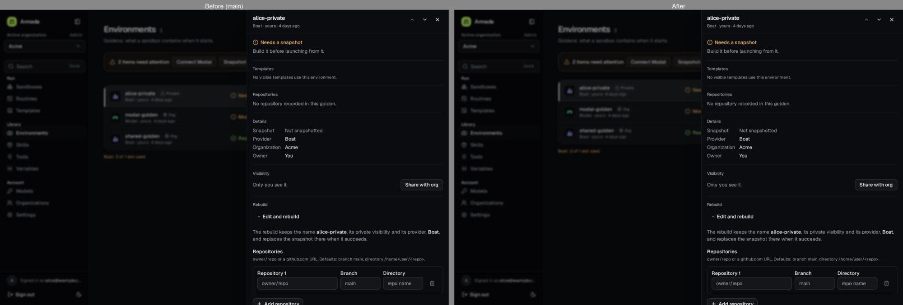
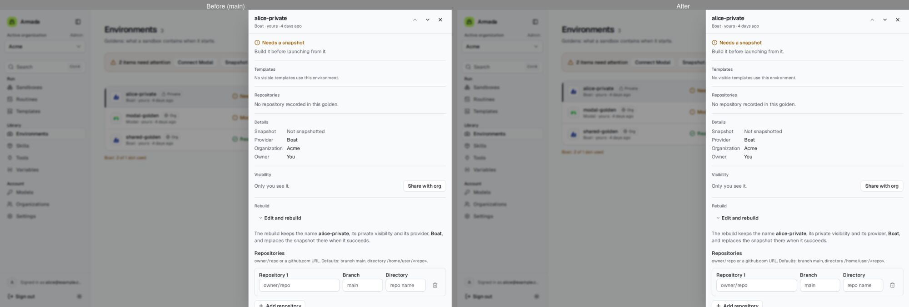
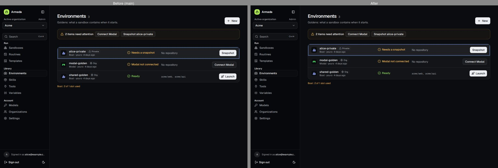
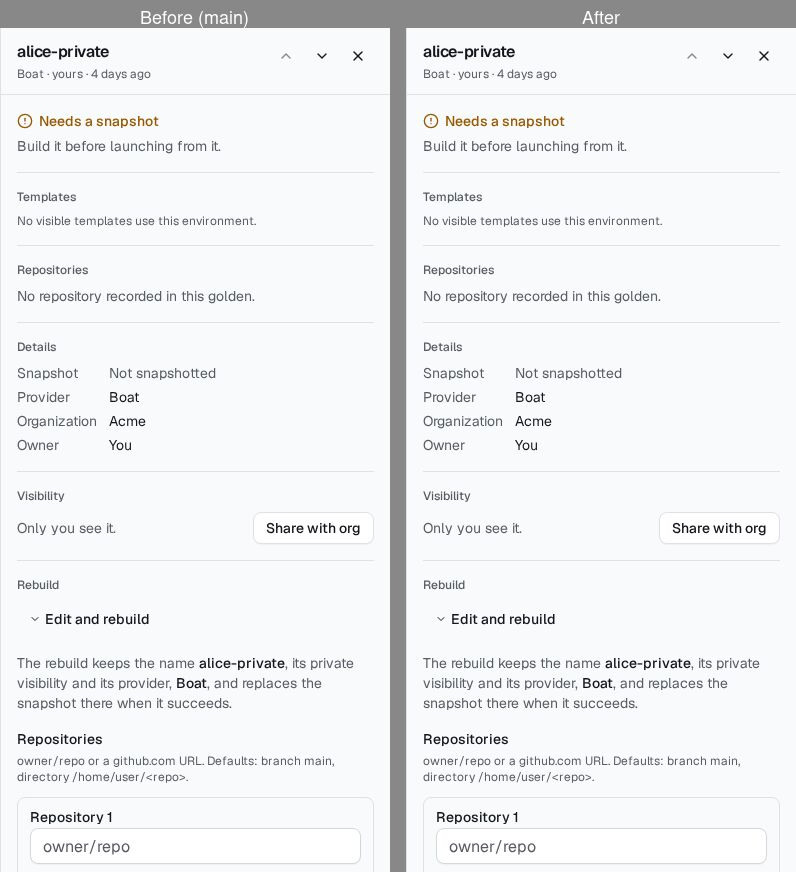
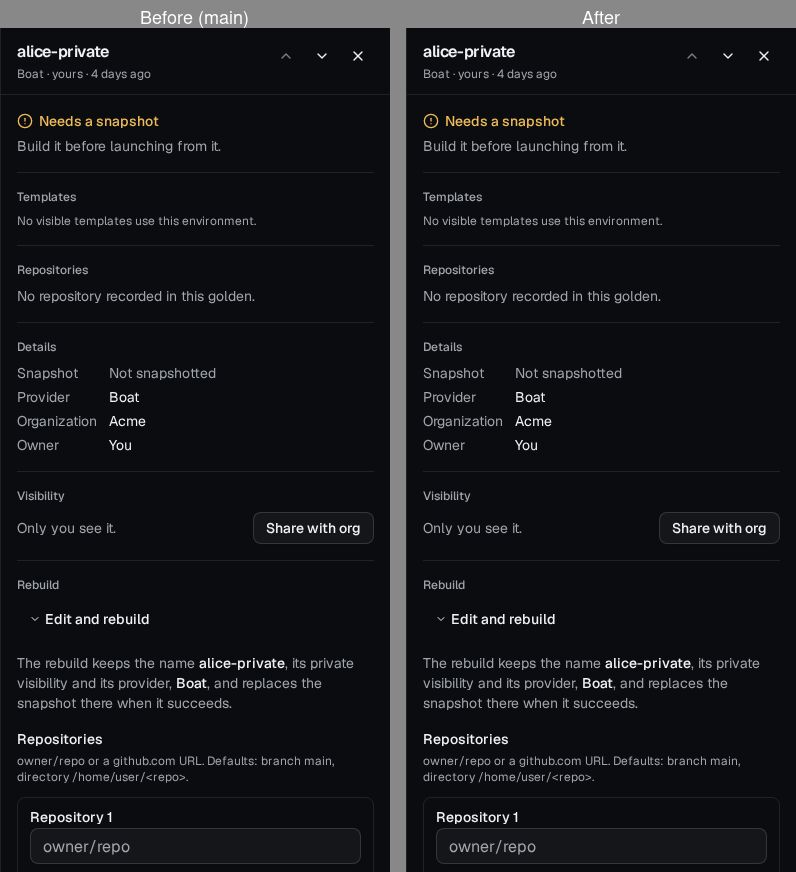
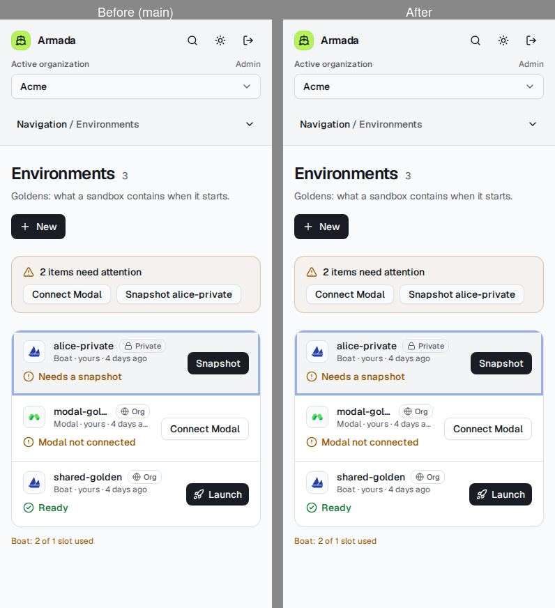
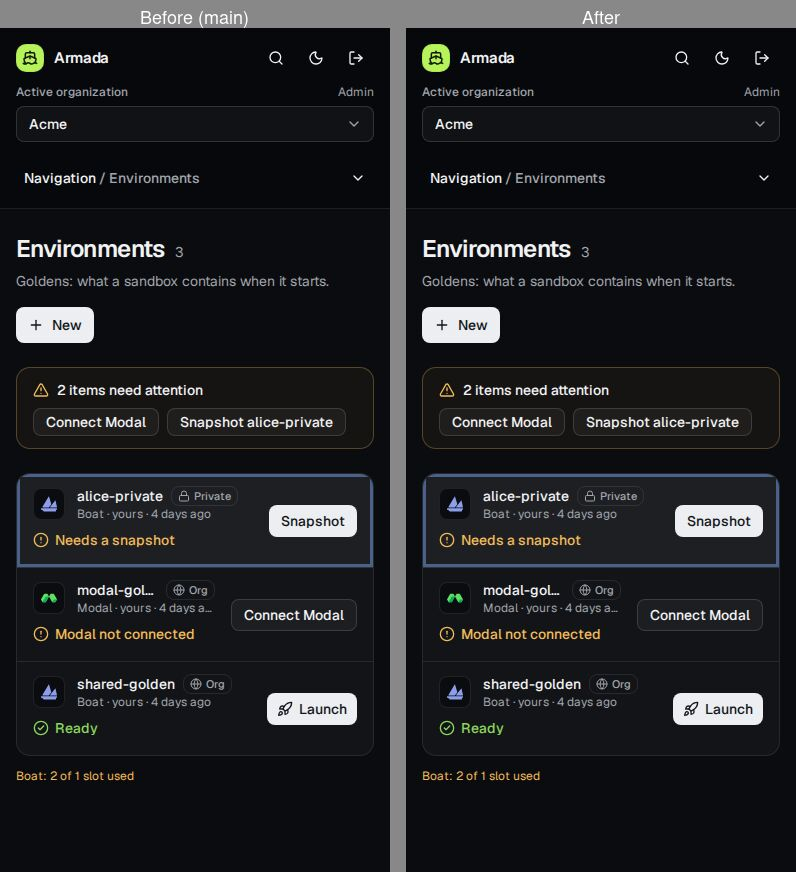

# #1153: the right-hand panel is the only detail mode

Before (main) on the left, after on the right, from fresh production builds of both sides with the e2e mock data.
Desktop (1280 px) and phone (390 px), light and dark; each pair shows Environments with `alice-private` open, then
after Escape (the panel closed, the URL back to the list, focus on the row).

Every list page already used the panel, so the panel itself is unchanged. The one visible difference: on desktop the
empty element that parks the closed panel no longer takes a grid row above the list, so the 16 px gap between the
attention strip and the list is gone.

