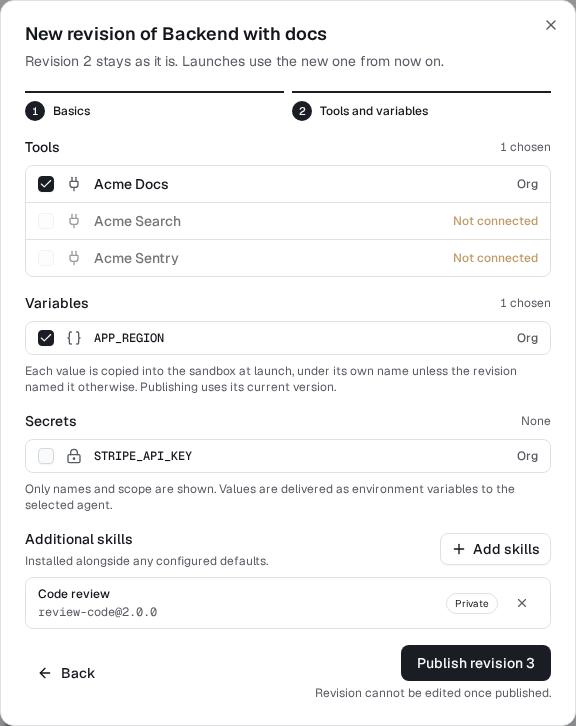

# Choose skills in template revisions (#1007)

The existing two-step template form reuses the Skillpack picker in step 2.
Choose exact public/workspace versions, or enter pins when discovery is
unavailable. Editing starts with the revision's saved pins; unrelated edits
preserve them, and removing them publishes an empty list in the new revision.
Previous revisions remain immutable. Main’s secret-reference selection is preserved alongside skills; values/delivery are unchanged. Existing model account/version, variable
and optimistic-revision checks are unchanged.

Template launch's read-only preset summary shows its pinned skills. It is not
a preview of all default skills resolved at admission.

This is a synthetic fixture screenshot from the real production dashboard,
cropped only for readability. Targeted unit regressions cover preserving,
replacing and clearing pins; browser evidence publishes successive revisions
and verifies all earlier pins remain unchanged.

No migrations. Depends on the shared Launch picker/catalog slices. Coordinator
staging: publish a public+private template revision, launch on Boat and Modal,
check recorded receipts, edit the name without losing pins, then publish a
revision that removes them. Workers hold no staging credentials.
